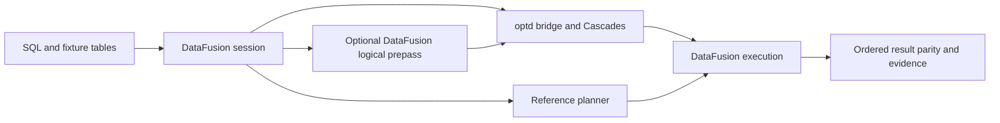
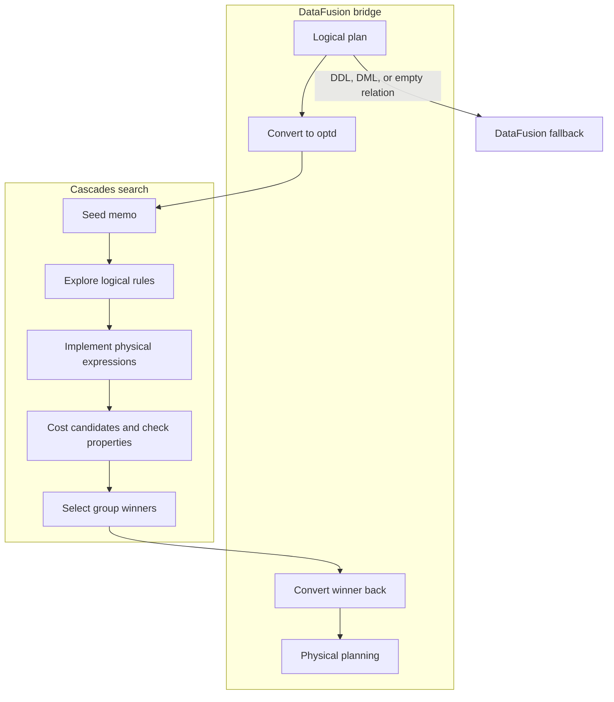

# SQL query optimizer

This project preserves the complete [CMU optd-original](https://github.com/cmu-db/optd-original) implementation and Git history. The upstream supplies the optimizer; the additions here are a skewed SQL parity executable, retained memo/plan diagnostics, a reusable verification driver and credential-free CI. This studies the [CMU 15-721 Spring 2024 project showcase](https://15721.courses.cs.cmu.edu/spring2024/project-showcase.html), without claiming enrollment, authorship of optd, or course completion.

## Contents

- [Run](#run)
- [Architecture and execution guide](#architecture-and-execution-guide)
- [Mechanism map](#mechanism-map)
- [Implementation techniques](#implementation-techniques)
- [Provenance and limits](#provenance-and-limits)
- [Reproduce optimizer measurements](#reproduce-optimizer-measurements)

## Architecture and execution guide

The retained workspace supplies the optimizer and DataFusion integration. The local `memoir` example adds fixture setup, result parity, retained diagnostics, and an explicit hybrid comparison. DataFusion parses and executes SQL; optd searches for a physical plan. The hybrid arm keeps DataFusion's logical optimizer before optd, including filter propagation for selective joins. The skewed fixture does not make fallback cost estimates skew-aware.

The first diagram shows the example boundary. Both optimized and reference queries execute through DataFusion.



The inner flow converts supported plans to optd, explores alternatives, and converts a winner back. DDL, DML, and empty relations fall back to DataFusion's planner.



| Subsystem | Responsibility and owned state | Source |
| --- | --- | --- |
| Bridge | Converts DataFusion plans and catalog schemas to optd, then returns a DataFusion physical plan. | [`lib.rs`](optd-datafusion-bridge/src/lib.rs), [`into_optd.rs`](optd-datafusion-bridge/src/into_optd.rs), [`from_optd.rs`](optd-datafusion-bridge/src/from_optd.rs) |
| Memo and task runner | Holds equivalent expressions, exploration state, and candidate winners; budgets limit rule expansion. | [`memo.rs`](optd-core/src/cascades/memo.rs), [`tasks2.rs`](optd-core/src/cascades/tasks2.rs), [`optimizer.rs`](optd-core/src/cascades/optimizer.rs) |
| Rules and cost | Defines rewrites, implementations, and estimates used to rank alternatives. | [`rules`](optd-datafusion-repr/src/rules), [`cost`](optd-datafusion-repr/src/cost) |
| Properties | Tracks logical facts and physical requirements during plan selection. | [`physical_property.rs`](optd-core/src/physical_property.rs), [`logical_property.rs`](optd-core/src/logical_property.rs) |
| Example | Creates fixtures and retains SQL, results, plans, and the costed memo. | [`memoir.rs`](optd-datafusion-bridge/examples/memoir.rs) |
| Hybrid comparison | Retains DataFusion logical rules before optd physical planning when `use_df_logical` is enabled. | [`create_df_context`](optd-datafusion-bridge/src/lib.rs), [`benchmark`](optd-datafusion-bridge/examples/memoir.rs) |

Execution journey:

1. The example registers in-memory tables and submits SQL to DataFusion.
2. The default arm disables DataFusion logical rules. The explicit hybrid arm retains those rules before the bridge converts supported nodes and fields. Unsupported conversions fail; DDL, DML, and empty relations use the default planner.
3. Cascades stores alternatives in a [memo group](#memo-group), applies logical rewrites and [implementation rules](#implementation-rule), then selects winners using costs and [physical properties](#physical-property).
4. The bridge converts the winner to a DataFusion plan, which executes it. A separate DataFusion session provides the reference result.
5. The example compares ordered typed results and saves the plan and memo. Conversion, exploration, execution, or parity errors fail the run.

| Choice | Current implementation and rationale inferred from code | Alternative and cost to reconsider |
| --- | --- | --- |
| Keep DataFusion as parser and executor | optd changes search while DataFusion retains catalog and execution behavior. | A separate executor gives control but duplicates operator semantics. |
| Store alternatives in memo groups | Equivalent plans share group identity and winner state. | Tree rewriting is easier to inspect but does not share alternatives or winner state. |
| Budget exploration | Task counters and configured budgets bound logical expansion. | Exhaustive search can add alternatives at greater search and memory cost. |
| Rank with a cost model | Candidate selection uses estimates; fixture skew is not inferred. | Runtime feedback may improve estimates but requires workload data and more validation. |
| Compare with an independent session | Ordered typed parity checks behavior without asserting plan quality. | Golden results are simpler but can miss engine-dependent output differences. |
| Keep the hybrid arm explicit | Reuses DataFusion logical rewrites while retaining optd physical search. | Standalone optd isolates its rules, but can miss filter propagation and process more join rows. The measured benefit depends on the query. |

These are implementation tradeoffs, not recorded historical intent. The fixture proves parity and exploration, not optimal plans or production readiness.

<a id="memo-group"></a>

<details><summary>What is a memo group?</summary>

A memo group holds expressions that represent equivalent relational results. Cascades shares alternatives in groups so it can compare implementations. The example retains the full costed memo.

</details>

<a id="implementation-rule"></a>

<details><summary>What is an implementation rule?</summary>

An implementation rule maps a logical expression to a physical operator candidate. The task runner applies these after logical exploration.

</details>

<a id="physical-property"></a>

<details><summary>What is a physical property?</summary>

A physical property describes a requirement such as ordering or distribution. optd tracks these when selecting winners; the SQL fixture does not exercise every property.

</details>

<a id="logical-property"></a>

<details><summary>What is a logical property?</summary>

A logical property records facts about a relational result for use by rules. Property inference coverage depends on the plan and supported types.

</details>

<a id="cost-model"></a>

<details><summary>What is a cost model?</summary>

A cost model estimates relative plan expense. The example uses fallback table estimates and does not infer its skewed fixture distribution.

</details>

## Implementation techniques

Scope: these cards cover the active `memoir` optimizer, DataFusion bridge, and fixture driver. Rationale is inferred from current code, not historical author intent.

| Active subsystem | Techniques | Source files |
| --- | --- | --- |
| Memo representation | [Cascades memo groups and expression sharing](#technique-cascades-memo) | [`memo.rs`](optd-core/src/cascades/memo.rs) |
| Cascades search and budgeting | [Cascades rule exploration and implementation](#technique-cascades-rule-exploration), [Rule exploration budgets](#technique-search-budget-gates), [Cost and row-estimate winner selection](#technique-cost-based-winner-selection) | [`tasks2.rs`](optd-core/src/cascades/tasks2.rs), [`optimizer.rs`](optd-core/src/cascades/optimizer.rs) |
| Relational rewrites and implementation | [Join commutation and association](#technique-join-order-rewrites), [Predicate classification and filter pushdown](#technique-filter-pushdown), [Projection merging and transposition](#technique-projection-transposition), [Physical operator implementation alternatives](#technique-physical-implementation), [Predicate and redundant-operator simplification](#technique-expression-and-operator-simplification) | [`joins.rs`](optd-datafusion-repr/src/rules/joins.rs), [`filter_pushdown.rs`](optd-datafusion-repr/src/rules/filter_pushdown.rs), [`project_transpose_common.rs`](optd-datafusion-repr/src/rules/project_transpose/project_transpose_common.rs), [`project_filter_transpose.rs`](optd-datafusion-repr/src/rules/project_transpose/project_filter_transpose.rs), [`physical.rs`](optd-datafusion-repr/src/rules/physical.rs), [`filter.rs`](optd-datafusion-repr/src/rules/filter.rs), [`eliminate_limit.rs`](optd-datafusion-repr/src/rules/eliminate_limit.rs), [`eliminate_duplicated_expr.rs`](optd-datafusion-repr/src/rules/eliminate_duplicated_expr.rs) |
| Cost and properties | [Cost and row-estimate winner selection](#technique-cost-based-winner-selection), [Physical property interfaces and limits](#technique-required-physical-properties) , [Logical property derivation](#technique-derived-logical-properties) | [`base_cost.rs`](optd-datafusion-repr/src/cost/base_cost.rs), [`physical_property.rs`](optd-core/src/physical_property.rs), [`logical_property.rs`](optd-core/src/logical_property.rs) |
| DataFusion bridge and hybrid planner | [DataFusion and optd plan conversion](#technique-datafusion-optd-plan-conversion), [DataFusion logical-prepass hybrid](#technique-datafusion-logical-prepass) | [`lib.rs`](optd-datafusion-bridge/src/lib.rs), [`into_optd.rs`](optd-datafusion-bridge/src/into_optd.rs), [`from_optd.rs`](optd-datafusion-bridge/src/from_optd.rs) |
| Memoir fixture and parity driver | [DataFusion logical-prepass hybrid](#technique-datafusion-logical-prepass), [Ordered typed result parity verification](#technique-result-parity-and-plan-evidence) | [`memoir.rs`](optd-datafusion-bridge/examples/memoir.rs) |

<a id="technique-expression-and-operator-simplification"></a>

<details>
<summary>Predicate and redundant-operator simplification</summary>

**Mechanism.** Filter rules simplify boolean predicates and remove filters that become true. Separate rules remove limits with no effective skip or fetch and collapse duplicated sort or aggregate expressions.

**Example.** A filter whose simplified condition is `TRUE` can be removed; a no-op limit can return its child plan.

**Why here.** These rewrites reduce redundant logical work before Cascades chooses physical operators.

**Tradeoffs.** Each rule handles specific expression and operator shapes. Simplification does not replace general theorem proving or constant folding across unsupported expression forms.

**Code and ownership.** [`optd-datafusion-repr/src/rules/filter.rs#L94`](optd-datafusion-repr/src/rules/filter.rs#L94) (`apply_simplify_filter`); [`optd-datafusion-repr/src/rules/eliminate_limit.rs#L22`](optd-datafusion-repr/src/rules/eliminate_limit.rs#L22) (`apply_eliminate_limit`); [`optd-datafusion-repr/src/rules/eliminate_duplicated_expr.rs#L79`](optd-datafusion-repr/src/rules/eliminate_duplicated_expr.rs#L79) (`apply_eliminate_duplicated_agg_expr`). Origin: inherited.
</details>

<a id="technique-cascades-memo"></a>

<details>
<summary>Cascades memo groups and expression sharing</summary>

**Mechanism.** Memo groups hold equivalent expressions, with child references stored as group IDs. Hash indexes deduplicate expressions and predicates; merges redirect group IDs and repair child references. Winner records stay on groups.

**Example.** A join and its commuted form can live in one group while sharing unchanged input groups.

**Why here.** The active path needs this step to share equivalent alternatives and their winner state.

**Tradeoffs.** The search compares alternatives without copying each full tree. Group merging repairs indexes and can recursively merge duplicate groups.

**Code and ownership.** [`optd-core/src/cascades/memo.rs#L24`](optd-core/src/cascades/memo.rs#L24) (`MemoPlanNode`). Origin: inherited.
</details>

<a id="technique-cascades-rule-exploration"></a>

<details>
<summary>Cascades rule exploration and implementation</summary>

**Mechanism.** The task runner expands logical expressions with transformation rules, recursively explores child groups, then applies implementation rules. It marks fired rules and started tasks to avoid repeated work.

**Example.** For three joined tables, commute and associate join alternatives, then implement a hash join for supported shapes.

**Why here.** The active path needs this step to produce equivalent logical alternatives and physical candidates for costing.

**Tradeoffs.** Exploration can grow the memo. This is sequential task execution, not parallel search; recursive search uses a grown stack.

**Code and ownership.** [`optd-core/src/cascades/tasks2.rs#L139`](optd-core/src/cascades/tasks2.rs#L139) (`optimize_expr_inner`); [`optd-core/src/cascades/tasks2.rs#L235`](optd-core/src/cascades/tasks2.rs#L235) (`apply_rule_inner`). Origin: inherited.
</details>

<a id="technique-search-budget-gates"></a>

<details>
<summary>Rule exploration budgets</summary>

**Mechanism.** The optimizer can stop logical rewrites when rule-step or plan-space limits are exceeded. The task runner continues implementation rules after the logical budget; an all-rules budget may stop once a group has a winner.

**Example.** Set `partial_explore_space` or `partial_explore_iter` to cap expansion before plan selection.

**Why here.** The active path needs this step to bound logical expansion when callers configure a search limit.

**Tradeoffs.** A capped search may omit a cheaper alternative. The fixture uses project defaults and does not claim exhaustive search.

**Code and ownership.** [`optd-core/src/cascades/optimizer.rs#L41`](optd-core/src/cascades/optimizer.rs#L41) (`OptimizerProperties`); [`optd-core/src/cascades/tasks2.rs#L235`](optd-core/src/cascades/tasks2.rs#L235) (`apply_rule_inner`). Origin: inherited.
</details>

<a id="technique-join-order-rewrites"></a>

<details>
<summary>Join commutation and association</summary>

**Mechanism.** Logical join rules swap inner-join inputs and reassociate compatible joins, producing equivalent join trees in the memo. Cascades costs the alternatives rather than selecting one greedy rewrite.

**Example.** `(orders JOIN customers) JOIN regions` can be represented with a different inner-join order for costing.

**Why here.** The active path needs this step to compare inner-join trees whose input order changes work.

**Tradeoffs.** Each additional join can enlarge candidates. Rewrites apply only to supported join types and rule bindings.

**Code and ownership.** [`optd-datafusion-repr/src/rules/joins.rs#L28`](optd-datafusion-repr/src/rules/joins.rs#L28) (`apply_join_commute`); [`optd-datafusion-repr/src/rules/joins.rs#L112`](optd-datafusion-repr/src/rules/joins.rs#L112) (`apply_join_assoc`). Origin: inherited.
</details>

<a id="technique-filter-pushdown"></a>

<details>
<summary>Predicate classification and filter pushdown</summary>

**Mechanism.** The rule classifies conjuncts by referenced input columns. It pushes left-only or right-only conditions below an inner join, retains cross-input conditions at the join, and has separate transpose rules for sort and aggregate. The fixture asserts scan-adjacent filters.

**Example.** A predicate on `orders.amount` can move beneath a join that also reads customers and regions.

**Why here.** The active path needs this step to reduce rows before later joins when dependencies allow movement.

**Tradeoffs.** Movement depends on join type and expression dependencies. Pushdown changes filter placement, not fallback selectivity accuracy.

**Code and ownership.** [`optd-datafusion-repr/src/rules/filter_pushdown.rs#L66`](optd-datafusion-repr/src/rules/filter_pushdown.rs#L66) (`determine_join_cond_dep`); [`optd-datafusion-repr/src/rules/filter_pushdown.rs#L183`](optd-datafusion-repr/src/rules/filter_pushdown.rs#L183) (`filter_join_transpose`). Origin: inherited.
</details>

<a id="technique-projection-transposition"></a>

<details>
<summary>Projection merging and transposition</summary>

**Mechanism.** Projection rules compose column mappings, merge adjacent projections, and transpose projections across filters or joins when referenced columns can be remapped. They preserve required columns while changing plan placement.

**Example.** A filter on a projected column is rewritten against the input column and placed below a projection when its mapping is valid.

**Why here.** The active path needs this step to remove redundant projection work and expose eligible predicates.

**Tradeoffs.** Mappings that cannot be represented safely decline the rewrite. Required parent expressions can keep intermediate columns.

**Code and ownership.** [`optd-datafusion-repr/src/rules/project_transpose/project_transpose_common.rs#L21`](optd-datafusion-repr/src/rules/project_transpose/project_transpose_common.rs#L21) (`ProjectionMapping`); [`optd-datafusion-repr/src/rules/project_transpose/project_filter_transpose.rs#L93`](optd-datafusion-repr/src/rules/project_transpose/project_filter_transpose.rs#L93) (`apply_filter_project_transpose`). Origin: inherited.
</details>

<a id="technique-physical-implementation"></a>

<details>
<summary>Physical operator implementation alternatives</summary>

**Mechanism.** Implementation rules map logical scans, projections, filters, sorts, aggregates, limits, and joins to physical nodes. Join rules offer hash and nested-loop implementations when keys and predicates qualify.

**Example.** A logical equijoin can yield a physical hash-join candidate for costing.

**Why here.** The active path needs this step to turn logical operators into DataFusion-executable candidates.

**Tradeoffs.** Only implemented supported shapes become candidates. A candidate name does not prove it wins or performs better.

**Code and ownership.** [`optd-datafusion-repr/src/rules/physical.rs#L14`](optd-datafusion-repr/src/rules/physical.rs#L14) (`PhysicalConversionRule`); [`optd-datafusion-repr/src/rules/joins.rs#L149`](optd-datafusion-repr/src/rules/joins.rs#L149) (`apply_hash_join`). Origin: inherited.
</details>

<a id="technique-cost-based-winner-selection"></a>

<details>
<summary>Cost and row-estimate winner selection</summary>

**Mechanism.** For each physical expression, the task runner combines operation cost with child winner costs, derives output statistics, and retains the lower weighted-cost winner. The default DataFusion model estimates scans from catalog counts or a 1000-row fallback, fixed filter selectivity, and simplified join cardinality.

**Example.** The memo winner carries compute and I/O cost plus estimated rows; the dump exposes those fields.

**Why here.** The active path needs this step to rank physical candidates using the configured estimates.

**Tradeoffs.** Estimates are not measured runtime. The skewed fixture is not modeled as skewed by fallback estimates, so a chosen plan is not guaranteed optimal.

**Code and ownership.** [`optd-core/src/cascades/tasks2.rs#L408`](optd-core/src/cascades/tasks2.rs#L408) (`gather_statistics_and_costs`); [`optd-datafusion-repr/src/cost/base_cost.rs#L19`](optd-datafusion-repr/src/cost/base_cost.rs#L19) (`DfCostModel`). Origin: mixed.
</details>

<a id="technique-required-physical-properties"></a>

<details>
<summary>Physical property interfaces and limits</summary>

**Mechanism.** Memo groups retain inferred logical properties, while physical-property builders describe physical requirements and enforcers. The core optimizer API exposes required-property optimization, but that entry point is unimplemented.

**Example.** The existing property tests exercise order and distribution checks through property interfaces.

**Why here.** The active path needs this step to represent facts and requirements during plan selection.

**Tradeoffs.** The SQL fixture does not establish general required-property optimization or satisfaction for every plan.

**Code and ownership.** [`optd-core/src/physical_property.rs#L18`](optd-core/src/physical_property.rs#L18) (`PhysicalProperty`). Origin: inherited.
</details>

<a id="technique-datafusion-optd-plan-conversion"></a>

<details>
<summary>DataFusion and optd plan conversion</summary>

**Mechanism.** The bridge reads catalog schemas, converts supported DataFusion logical nodes and expressions into optd nodes, then rebuilds DataFusion physical operators from the winner. Unsupported conversion returns errors; DDL, DML, and empty relations use DataFusion's default physical planner.

**Example.** A parsed SELECT becomes optd scan, join, and filter nodes, then returns as DataFusion execution nodes.

**Why here.** The active path needs this step to connect DataFusion SQL planning to optd search and back to execution.

**Tradeoffs.** The bridge supports a bounded node and type set. Output naming and conversion limits are documented elsewhere in this README.

**Code and ownership.** [`optd-datafusion-bridge/src/into_optd.rs#L604`](optd-datafusion-bridge/src/into_optd.rs#L604) (`conv_into_optd_plan_node`); [`optd-datafusion-bridge/src/from_optd.rs#L571`](optd-datafusion-bridge/src/from_optd.rs#L571) (`conv_from_optd_plan_node`); [`optd-datafusion-bridge/src/lib.rs#L120`](optd-datafusion-bridge/src/lib.rs#L120) (`create_physical_plan_inner`). Origin: inherited.
</details>

<a id="technique-datafusion-logical-prepass"></a>

<details>
<summary>DataFusion logical-prepass hybrid</summary>

**Mechanism.** The hybrid context retains DataFusion logical optimization before optd physical planning. The benchmark labels this separate arm `optd_df_logical`; it then uses the optd bridge, Cascades search, execution, and typed parity checks.

**Example.** A selective join can enter optd with a derived order filter already propagated by DataFusion.

**Why here.** The active path needs this step to measure the existing DataFusion logical rewrites with optd physical search.

**Tradeoffs.** This changes the optimizer stack and planning work. Results apply only to the configured arm and query set.

**Code and ownership.** [`optd-datafusion-bridge/src/lib.rs#L326`](optd-datafusion-bridge/src/lib.rs#L326) (`create_df_context`); [`optd-datafusion-bridge/examples/memoir.rs#L206`](optd-datafusion-bridge/examples/memoir.rs#L206) (`benchmark`). Origin: mixed.
</details>

<a id="technique-result-parity-and-plan-evidence"></a>

<details>
<summary>Ordered typed result parity verification</summary>

**Mechanism.** The fixture seeds identical in-memory tables in separate optimizer and reference contexts, executes the same SQL, compares ordered formatted rows and physical output types, checks expected row counts, and retains EXPLAIN plans and costed memo dumps. Benchmark arms also compare pairwise.

**Example.** The empty query checks zero rows; the selective join stores its execution plan after result comparison.

**Why here.** The active path needs this step to check query behavior against an independent DataFusion session.

**Tradeoffs.** Parity proves the exercised inputs and checks, not all SQL semantics, plan optimality, or production readiness. Value comparison uses array formatting.

**Code and ownership.** [`optd-datafusion-bridge/examples/memoir.rs#L17`](optd-datafusion-bridge/examples/memoir.rs#L17) (`rows`); [`optd-datafusion-bridge/examples/memoir.rs#L80`](optd-datafusion-bridge/examples/memoir.rs#L80) (`main`). Origin: extension.
</details>

## Run

Install Rust 1.99.1 and native C/C++ build tools. The checked-in Cargo.lock fixes the archived graph. From this directory:

```sh
cargo +1.99.1 run --locked -p optd-datafusion-bridge --example memoir -- evidence/memoir
```

The example seeds in-memory tables, parses real SQL, optimizes through the existing DataFusion bridge and Cascades engine, executes physical plans, and compares ordered results with an independent ordinary DataFusion session. It covers a filtered three-table join on skewed data, grouped aggregation and an empty result. Each query saves SQL, results, verbose plan and full costed memo. Failed parity or exploration returns a nonzero exit status.

PowerShell 7 lifecycle:

```powershell
pwsh -File tools/verification/verify.ps1 Launch
pwsh -File tools/verification/verify.ps1 Doctor
pwsh -File tools/verification/verify.ps1 Drive
pwsh -File tools/verification/verify.ps1 Evidence
pwsh -File tools/verification/verify.ps1 Cleanup
pwsh -File tools/verification/verify.ps1 Evidence
```

The driver uses two jobs and no debug symbols. Fixtures live inside the short-lived process; evidence survives cleanup. See [.agents/skills/verify-memoir](.agents/skills/verify-memoir/SKILL.md). The full upstream interactive CLI is retained: `cargo +1.99.1 run --locked --bin datafusion-optd-cli`; its larger dependency surface is outside the fixture acceptance check.

## Mechanism map

| Mechanism | Existing implementation | Acceptance evidence |
| --- | --- | --- |
| Memo groups, equivalent expressions, merging | optd-core/src/cascades/memo.rs | Core tests; memo expressions |
| Cascades tasks, scheduling, pruning | optd-core/src/cascades/tasks2.rs and optimizer.rs | Costed physical winners and join alternatives |
| Join commutation/association, filter movement | optd-datafusion-repr/src/rules | EXPLAIN alternatives and pushed filters |
| Cardinality and compute/I/O estimates | optd-datafusion-repr/src/cost | Verbose costs and row counts |
| Advanced statistics | optd-datafusion-repr-adv-cost and optd-gungnir | Preserved implementation, separate package tests |
| Logical/physical properties | optd-core/src/physical_property.rs and tests/heuristics_physical_property.rs | Existing property enforcement tests |
| SQL planning and physical execution | optd-datafusion-bridge/src | Three queries equal ordinary DataFusion |

```sh
cargo +1.99.1 test --locked -p optd-core --lib
cargo +1.99.1 test --locked -p optd-datafusion-repr --lib
cargo +1.99.1 fmt --all -- --check
cargo +1.99.1 clippy --locked -p optd-datafusion-bridge --example memoir --no-deps
```

## Provenance and limits

Fork base: `c7f727f9e862beed6be5515eb2bb223d1c8bd8c3`. [README.upstream.md](README.upstream.md) is the unchanged original overview. MIT LICENSE and Apache notices in the vendored DataFusion CLI are preserved. The pinned graph uses DataFusion 43 and Arrow 53; the upstream overview's version-32 reference is historical. No replacement optimizer or new third-party package is introduced; the example adds a direct development reference to the already-locked Tokio runtime.

The default cost model uses fallback table estimates and does not infer fixture skew. The harness proves parity, exploration and cost-based selection, not optimal runtime or calibrated cardinality. Generic physical properties have unit coverage; the SQL fixture does not assert every sort/distribution property. Upstream is research software unsuitable for production. Adaptive behavior, all SQL/types, Postgres benchmarks and cloud object stores are not exhaustively verified. The documented acceptance path needs no database service, credentials, GPU or paid compute.

The upstream bridge rewrites output field names (for example aliases become col0/col1, aggregates use generic names). Verification compares ordered typed values and expected row counts, retains separate actual/reference displays, and does not claim alias preservation. Empty results exercise zero rows; they do not prove physical schema equality when either engine emits no batches.

The new example denies Clippy warnings in its source. The no-deps Clippy command reports inherited bridge warnings; strict workspace Clippy on Rust 1.99.1 also fails on pre-existing upstream lints. The original upstream CI is preserved; the separate optimizer workflow exercises the local SQL acceptance path.
## Reproduce optimizer measurements

The [typed-result benchmark](docs/benchmarks/2026-10-22-typed-baseline.md) reports all five queries at all three data sizes. On a four-logical-CPU AMD EPYC 9V74 Ubuntu runner, the million-order aggregate took 25.350 ms [25.262, 25.549] through optd versus 50.680 ms [44.784, 55.704] through DataFusion, including planning. The selective join instead took 5.023 ms [4.948, 5.112] versus 3.120 ms [2.441, 3.223]. Values are medians and min/max of five alternating pairs using the observed Rust 1.99.0 release toolchain. All 180 actions passed ordered-value and physical-type parity. The artifact retains optimizer overhead, plan regressions and incomplete estimates; no general optimizer speedup or cardinality-quality claim follows. The complete million-order process peaked at 240,124 KiB RSS across both sides and all queries.

Build `cargo +1.99.1 build --release --locked -p optd-datafusion-bridge --example memoir --jobs 2`. Run `target/release/examples/memoir --benchmark evidence/benchmark/rows-100000 100000 5`, repeating at 1,000 and 1,000,000 orders, then run `python3 tools/verification/summarize_benchmark.py evidence/benchmark`. The manual [benchmark workflow](.github/workflows/benchmark.yml) retains these runs on an isolated Ubuntu host.

Five alternating optd/DataFusion pairs per query retain planning, execution and combined duration, exact result parity, executed plans with operator metrics, estimates, runner details and resources. Both sides use four target partitions and batch size 8192. Fixtures have 80% of orders assigned to customer zero. Fixture construction and output formatting are outside the timers, so the result covers an in-memory SQL consumer. The summary rejects missing or duplicate repetitions and distinguishes root plan statistics from optd's internal estimates. No optimizer benefit is established by the setup smoke check.

The optional `--benchmark-hybrid` command adds the bridge's existing DataFusion logical prepass as a separately labeled `optd_df_logical` arm. In the [full three-arm run](docs/benchmarks/2026-10-22-hybrid.md), the million-order selective join took 2.617 [2.602,2.687] ms with the prepass, versus standalone optd 4.660 [4.582,4.726] and DataFusion 2.957 [2.692,2.980]. Executed plans confirm a derived order filter reduces join input from 1m to 10k rows. Extra planning made the hybrid slower than standalone on every other size/query combination; the million-order aggregate took 27.779 [27.498,27.974] versus 24.629 [24.498,24.733] ms. These are five reversed-order totals on a four-logical-CPU AMD EPYC 7763 Ubuntu runner with Rust 1.99.1. All 270 actions passed typed parity; the whole three-arm million-order process peaked at 261,248 KiB RSS. Root estimates remain poor. The report retains all 15 cases, planning/execution costs, resources and raw artifacts. This is a different configured optimizer stack. The [hybrid workflow](.github/workflows/benchmark-hybrid.yml) defaults to a correctness smoke; `smoke=false` runs the full matrix and `summarize_benchmark.py OUTPUT --hybrid` requires all 45 groups.

<a id="technique-derived-logical-properties"></a>

<details>
<summary>Bottom-up logical property derivation</summary>

**Mechanism.** A typed builder derives a property from an operator, its predicates, and child properties. The memo-facing adapter erases concrete property types into trait objects. Before calling the typed builder, it downcasts every child property to the expected type, then boxes the derived result for storage.

**Example.** A property builder for a relational operator receives the corresponding properties already derived for its inputs; alternative expressions can reuse the memo representation rather than attach planner-specific concrete types to every API.

**Why here.** The optimizer can store different kinds of logical facts through a common interface while retaining typed implementations of each derivation.

**Tradeoffs.** Type erasure adds runtime downcasts. Supplying the wrong child property type panics at the checked downcast; the interface does not itself establish relational correctness or supply accurate statistics. Logical facts differ from required physical ordering or distribution.

**Code and ownership.** [`LogicalPropertyBuilder` and `derive_any`](optd-core/src/logical_property.rs#L31), inherited optd implementation.

</details>
