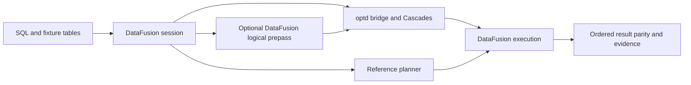
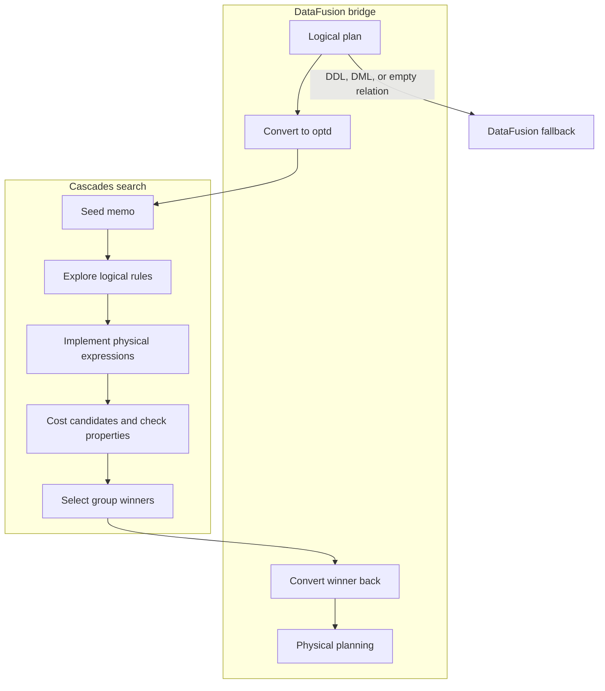

# SQL query optimizer

This project preserves the complete [CMU optd-original](https://github.com/cmu-db/optd-original) implementation and Git history. The upstream supplies the optimizer; the additions here are a skewed SQL parity executable, retained memo/plan diagnostics, a reusable verification driver and credential-free CI. This studies the [CMU 15-721 Spring 2024 project showcase](https://15721.courses.cs.cmu.edu/spring2024/project-showcase.html), without claiming enrollment, authorship of optd, or course completion.

## Contents

- [Run](#run)
- [Architecture and execution guide](#architecture-and-execution-guide)
- [Mechanism map](#mechanism-map)
- [Provenance and limits](#provenance-and-limits)
- [Reproduce optimizer measurements](#reproduce-optimizer-measurements)

## Architecture and execution guide

The retained workspace supplies the optimizer and DataFusion integration. The local `memoir` example adds fixture setup, result parity, retained diagnostics, and an explicit hybrid comparison. DataFusion parses and executes SQL; optd searches for a physical plan. The hybrid arm keeps DataFusion's logical optimizer before optd, including filter propagation for selective joins. The skewed fixture does not make fallback cost estimates skew-aware.

The first diagram shows the example boundary. Both optimized and reference queries execute through DataFusion.



The inner flow converts supported plans to optd, explores alternatives, and converts a winner back. DDL, DML, and empty relations fall back to DataFusion's planner.



| Subsystem | Responsibility and owned state | Source |
| --- | --- | --- |
| Bridge | Converts DataFusion plans and catalog schemas to optd, then returns a DataFusion physical plan. | [`lib.rs`](optd-datafusion-bridge/src/lib.rs), [`into_optd.rs`](optd-datafusion-bridge/src/into_optd.rs), [`from_optd.rs`](optd-datafusion-bridge/src/from_optd.rs) |
| Memo and task runner | Holds equivalent expressions, exploration state, and candidate winners; budgets limit rule expansion. | [`memo.rs`](optd-core/src/cascades/memo.rs), [`tasks2.rs`](optd-core/src/cascades/tasks2.rs), [`optimizer.rs`](optd-core/src/cascades/optimizer.rs) |
| Rules and cost | Defines rewrites, implementations, and estimates used to rank alternatives. | [`rules`](optd-datafusion-repr/src/rules), [`cost`](optd-datafusion-repr/src/cost) |
| Properties | Tracks logical facts and physical requirements during plan selection. | [`physical_property.rs`](optd-core/src/physical_property.rs), [`logical_property.rs`](optd-core/src/logical_property.rs) |
| Example | Creates fixtures and retains SQL, results, plans, and the costed memo. | [`memoir.rs`](optd-datafusion-bridge/examples/memoir.rs) |
| Hybrid comparison | Retains DataFusion logical rules before optd physical planning when `use_df_logical` is enabled. | [`create_df_context`](optd-datafusion-bridge/src/lib.rs), [`benchmark`](optd-datafusion-bridge/examples/memoir.rs) |

Execution journey:

1. The example registers in-memory tables and submits SQL to DataFusion.
2. The default arm disables DataFusion logical rules. The explicit hybrid arm retains those rules before the bridge converts supported nodes and fields. Unsupported conversions fail; DDL, DML, and empty relations use the default planner.
3. Cascades stores alternatives in a [memo group](#memo-group), applies logical rewrites and [implementation rules](#implementation-rule), then selects winners using costs and [physical properties](#physical-property).
4. The bridge converts the winner to a DataFusion plan, which executes it. A separate DataFusion session provides the reference result.
5. The example compares ordered typed results and saves the plan and memo. Conversion, exploration, execution, or parity errors fail the run.

| Choice | Current implementation and rationale inferred from code | Alternative and cost to reconsider |
| --- | --- | --- |
| Keep DataFusion as parser and executor | optd changes search while DataFusion retains catalog and execution behavior. | A separate executor gives control but duplicates operator semantics. |
| Store alternatives in memo groups | Equivalent plans share group identity and winner state. | Tree rewriting is easier to inspect but does not share alternatives or winner state. |
| Budget exploration | Task counters and configured budgets bound logical expansion. | Exhaustive search can add alternatives at greater search and memory cost. |
| Rank with a cost model | Candidate selection uses estimates; fixture skew is not inferred. | Runtime feedback may improve estimates but requires workload data and more validation. |
| Compare with an independent session | Ordered typed parity checks behavior without asserting plan quality. | Golden results are simpler but can miss engine-dependent output differences. |
| Keep the hybrid arm explicit | Reuses DataFusion logical rewrites while retaining optd physical search. | Standalone optd isolates its rules, but can miss filter propagation and process more join rows. The measured benefit depends on the query. |

These are implementation tradeoffs, not recorded historical intent. The fixture proves parity and exploration, not optimal plans or production readiness.

<a id="memo-group"></a>

<details><summary>What is a memo group?</summary>

A memo group holds expressions that represent equivalent relational results. Cascades shares alternatives in groups so it can compare implementations. The example retains the full costed memo.

</details>

<a id="implementation-rule"></a>

<details><summary>What is an implementation rule?</summary>

An implementation rule maps a logical expression to a physical operator candidate. The task runner applies these after logical exploration.

</details>

<a id="physical-property"></a>

<details><summary>What is a physical property?</summary>

A physical property describes a requirement such as ordering or distribution. optd tracks these when selecting winners; the SQL fixture does not exercise every property.

</details>

<a id="logical-property"></a>

<details><summary>What is a logical property?</summary>

A logical property records facts about a relational result for use by rules. Property inference coverage depends on the plan and supported types.

</details>

<a id="cost-model"></a>

<details><summary>What is a cost model?</summary>

A cost model estimates relative plan expense. The example uses fallback table estimates and does not infer its skewed fixture distribution.

</details>

## Run

Install Rust 1.99.1 and native C/C++ build tools. The checked-in Cargo.lock fixes the archived graph. From this directory:

```sh
cargo +1.99.1 run --locked -p optd-datafusion-bridge --example memoir -- evidence/memoir
```

The example seeds in-memory tables, parses real SQL, optimizes through the existing DataFusion bridge and Cascades engine, executes physical plans, and compares ordered results with an independent ordinary DataFusion session. It covers a filtered three-table join on skewed data, grouped aggregation and an empty result. Each query saves SQL, results, verbose plan and full costed memo. Failed parity or exploration returns a nonzero exit status.

PowerShell 7 lifecycle:

```powershell
pwsh -File tools/verification/verify.ps1 Launch
pwsh -File tools/verification/verify.ps1 Doctor
pwsh -File tools/verification/verify.ps1 Drive
pwsh -File tools/verification/verify.ps1 Evidence
pwsh -File tools/verification/verify.ps1 Cleanup
pwsh -File tools/verification/verify.ps1 Evidence
```

The driver uses two jobs and no debug symbols. Fixtures live inside the short-lived process; evidence survives cleanup. See [.agents/skills/verify-memoir](.agents/skills/verify-memoir/SKILL.md). The full upstream interactive CLI is retained: `cargo +1.99.1 run --locked --bin datafusion-optd-cli`; its larger dependency surface is outside the fixture acceptance check.

## Mechanism map

| Mechanism | Existing implementation | Acceptance evidence |
| --- | --- | --- |
| Memo groups, equivalent expressions, merging | optd-core/src/cascades/memo.rs | Core tests; memo expressions |
| Cascades tasks, scheduling, pruning | optd-core/src/cascades/tasks2.rs and optimizer.rs | Costed physical winners and join alternatives |
| Join commutation/association, filter movement | optd-datafusion-repr/src/rules | EXPLAIN alternatives and pushed filters |
| Cardinality and compute/I/O estimates | optd-datafusion-repr/src/cost | Verbose costs and row counts |
| Advanced statistics | optd-datafusion-repr-adv-cost and optd-gungnir | Preserved implementation, separate package tests |
| Logical/physical properties | optd-core/src/physical_property.rs and tests/heuristics_physical_property.rs | Existing property enforcement tests |
| SQL planning and physical execution | optd-datafusion-bridge/src | Three queries equal ordinary DataFusion |

```sh
cargo +1.99.1 test --locked -p optd-core --lib
cargo +1.99.1 test --locked -p optd-datafusion-repr --lib
cargo +1.99.1 fmt --all -- --check
cargo +1.99.1 clippy --locked -p optd-datafusion-bridge --example memoir --no-deps
```

## Provenance and limits

Fork base: `c7f727f9e862beed6be5515eb2bb223d1c8bd8c3`. [README.upstream.md](README.upstream.md) is the unchanged original overview. MIT LICENSE and Apache notices in the vendored DataFusion CLI are preserved. The pinned graph uses DataFusion 43 and Arrow 53; the upstream overview's version-32 reference is historical. No replacement optimizer or new third-party package is introduced; the example adds a direct development reference to the already-locked Tokio runtime.

The default cost model uses fallback table estimates and does not infer fixture skew. The harness proves parity, exploration and cost-based selection, not optimal runtime or calibrated cardinality. Generic physical properties have unit coverage; the SQL fixture does not assert every sort/distribution property. Upstream is research software unsuitable for production. Adaptive behavior, all SQL/types, Postgres benchmarks and cloud object stores are not exhaustively verified. The documented acceptance path needs no database service, credentials, GPU or paid compute.

The upstream bridge rewrites output field names (for example aliases become col0/col1, aggregates use generic names). Verification compares ordered typed values and expected row counts, retains separate actual/reference displays, and does not claim alias preservation. Empty results exercise zero rows; they do not prove physical schema equality when either engine emits no batches.

The new example denies Clippy warnings in its source. The no-deps Clippy command reports inherited bridge warnings; strict workspace Clippy on Rust 1.99.1 also fails on pre-existing upstream lints. The original upstream CI is preserved; the separate optimizer workflow exercises the local SQL acceptance path.
## Reproduce optimizer measurements

The [typed-result benchmark](docs/benchmarks/2026-10-22-typed-baseline.md) reports all five queries at all three data sizes. On a four-logical-CPU AMD EPYC 9V74 Ubuntu runner, the million-order aggregate took 25.350 ms [25.262, 25.549] through optd versus 50.680 ms [44.784, 55.704] through DataFusion, including planning. The selective join instead took 5.023 ms [4.948, 5.112] versus 3.120 ms [2.441, 3.223]. Values are medians and min/max of five alternating pairs using the observed Rust 1.99.0 release toolchain. All 180 actions passed ordered-value and physical-type parity. The artifact retains optimizer overhead, plan regressions and incomplete estimates; no general optimizer speedup or cardinality-quality claim follows. The complete million-order process peaked at 240,124 KiB RSS across both sides and all queries.

Build `cargo +1.99.1 build --release --locked -p optd-datafusion-bridge --example memoir --jobs 2`. Run `target/release/examples/memoir --benchmark evidence/benchmark/rows-100000 100000 5`, repeating at 1,000 and 1,000,000 orders, then run `python3 tools/verification/summarize_benchmark.py evidence/benchmark`. The manual [benchmark workflow](.github/workflows/benchmark.yml) retains these runs on an isolated Ubuntu host.

Five alternating optd/DataFusion pairs per query retain planning, execution and combined duration, exact result parity, executed plans with operator metrics, estimates, runner details and resources. Both sides use four target partitions and batch size 8192. Fixtures have 80% of orders assigned to customer zero. Fixture construction and output formatting are outside the timers, so the result covers an in-memory SQL consumer. The summary rejects missing or duplicate repetitions and distinguishes root plan statistics from optd's internal estimates. No optimizer benefit is established by the setup smoke check.

The optional `--benchmark-hybrid` command adds the bridge's existing DataFusion logical prepass as a separately labeled `optd_df_logical` arm. In the [full three-arm run](docs/benchmarks/2026-10-22-hybrid.md), the million-order selective join took 2.617 [2.602,2.687] ms with the prepass, versus standalone optd 4.660 [4.582,4.726] and DataFusion 2.957 [2.692,2.980]. Executed plans confirm a derived order filter reduces join input from 1m to 10k rows. Extra planning made the hybrid slower than standalone on every other size/query combination; the million-order aggregate took 27.779 [27.498,27.974] versus 24.629 [24.498,24.733] ms. These are five reversed-order totals on a four-logical-CPU AMD EPYC 7763 Ubuntu runner with Rust 1.99.1. All 270 actions passed typed parity; the whole three-arm million-order process peaked at 261,248 KiB RSS. Root estimates remain poor. The report retains all 15 cases, planning/execution costs, resources and raw artifacts. This is a different configured optimizer stack. The [hybrid workflow](.github/workflows/benchmark-hybrid.yml) defaults to a correctness smoke; `smoke=false` runs the full matrix and `summarize_benchmark.py OUTPUT --hybrid` requires all 45 groups.
